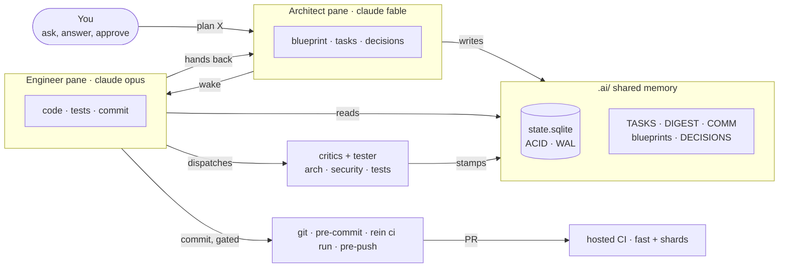
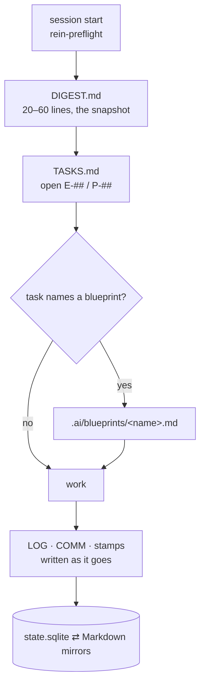
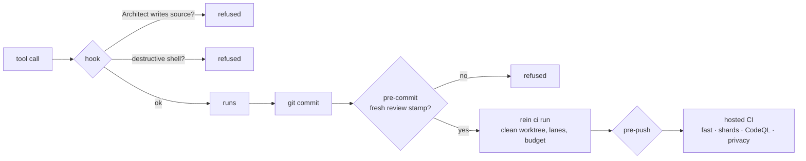
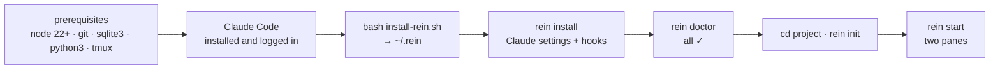

# Blueprint — README and docs: the pitch, the diagrams, the install guide (D-136)

## Goal & Architecture
The README is the product's front door and today it is accurate but flat: a wall of prose, an
ASCII diagram, a 60-second quickstart that assumes tmux and Claude Code are already set up, and
links to a `docs/` folder that does not exist in the public tree. After the rename (E-383) and
the mark (E-385), E-390 turns `README.md` into a page that sells the idea in the first screen,
explains it in diagrams a stranger reads in a minute, and walks a newcomer from an empty machine
to a running Architect and Engineer pane without a gap. Users: a developer finding the
repository (does this solve my problem, in ten seconds), a newcomer installing it (every step,
every OS, nothing assumed), a contributor (where the deep pages are). In one sentence: the
README answers *what*, *why* and *how fast*; `docs/` answers *how exactly*.

## Core Concept
Three layers with a strict split of duty:
- **`README.md`** — hero, pitch, the loop diagram, the 60-second quickstart, a feature tour in
  outcomes, and links. No step that needs more than one command block; nothing that belongs on
  a deep page is repeated here.
- **`docs/install.md`** — the complete step-by-step: prerequisites per OS (macOS, Ubuntu/Debian,
  Fedora, Arch, Windows via WSL2), tmux installation and the five tmux keys a user needs,
  Claude Code installation and login, then Rein itself, verification, first session, upgrade,
  uninstall. Every command block is one the Engineer ran.
- **`docs/how-it-works.md`, `docs/getting-started.md`, `docs/ci.md`** — the depth: the Triad,
  the memory, the gates, local and hosted CI. The README links each exactly once.
Diagrams are **Mermaid** fenced blocks: GitHub renders them natively, themes them for light and
dark, and they diff as text. The README has two images: the mark (D-134; `<picture>` with the
light and dark SVGs) and the demo GIF under the pitch (D-139; `.ai/blueprints/demo-video.md`).

## Components

### Component 1 — Hero and pitch (`README.md` top screen)
- Centered: the animated mark (D-134 r2) via `<picture>` (dark SVG under
  `prefers-color-scheme: dark`), the wordmark `Rein`, tagline **Rein in your agents.**, one
  sentence: *Claude Code as a small engineering team that plans, builds, reviews and remembers.*
- The manifesto line (operator, 2026-10-31; E-406), its own centered line directly under that
  sentence, verbatim: **Stop prompting the intelligence and start navigating it.** It is a
  statement, not a tagline: it keeps its full stop, is not italicised, and appears once in the
  README (the hero) and once as the opening line of `docs/how-it-works.md`.
- Badge row (D-133 r7) under the tagline.
- **The pitch, in outcomes, not features** — four short paragraphs, each with a bold lead:
  - **One chat forgets. A team remembers.** A single Claude session loses the plan when the
    context fills; Rein keeps the plan, the tasks, the decisions and the review stamps in
    `.ai/`, crash-safe, read first at every session start.
  - **Plan and build are different jobs.** An Architect pane that cannot touch source; an
    Engineer pane that cannot rewrite the plan. Each wakes the other when its turn ends; you
    watch and answer.
  - **Nothing merges on trust.** Independent critics review the diff; tests run in a clean
    worktree; a commit without a fresh review stamp is refused by a hook, not by a request.
  - **Local, thin, yours.** No proxy, no cloud service, no account beyond Claude Code. Apache
    2.0.
- **Who it is for**: one line each — a solo developer who wants a second opinion that cannot be
  talked out of the rules; a small team that wants one memory per repository; an existing
  codebase that needs to be understood before it is changed.
- **See it run** (D-139, E-402): directly under the pitch, `docs/assets/demo.gif` as a Markdown
  image with the alt text from `demo-video.md` §Component 5, then one caption line linking the
  MP4 release asset and `docs/assets/demo.cast`. It sits below the first viewport (the hero
  still fits one screen); no new HTML.

### Component 2 — Diagrams (Mermaid, four blocks)
The exact sources; the Engineer copies them and adjusts labels only if a command name changed.

**2a — The loop** (replaces the ASCII block under "How it works"):


**2b — What a session reads first** (under "Memory that survives the chat"):


**2c — The gate chain** (under "Gates, critics and budgets"):


**2d — The install path** (top of `docs/install.md`):


### Component 3 — `docs/install.md`, step by step
Numbered steps; each step is a heading, one sentence of why, the command block, and *what you
should see*. Nothing is assumed installed.
1. **Pick your OS** — sections by heading: macOS, Ubuntu/Debian, Fedora, Arch, Windows (WSL2).
   For WSL2: enable WSL, install Ubuntu from the Store, open it, then follow Ubuntu; note
   that everything below runs inside WSL and that Windows Terminal is recommended.
2. **Prerequisites per OS** — one block each, installing node 22+, git, sqlite3, python3 and
   tmux with the OS package manager (Homebrew on macOS; `apt` with Node from NodeSource or
   `fnm`; `dnf`; `pacman`). After the block: the four version commands and the expected
   first line of each.
3. **tmux in five keys** — `prefix` is `Ctrl-b`; `prefix %` split, `prefix o` switch pane,
   `prefix d` detach, `tmux attach -t <name>` return, `prefix [` scroll. A minimal
   `~/.tmux.conf` (mouse on, 256 colours) offered, not required. One session per project,
   named after it (the README's manual-fallback rule).
4. **Claude Code** — the explicit terminal steps, not a bare link (D-136 addendum, 2026-10-30).
   The step quotes the official "Get started" page (`https://docs.anthropic.com/en/docs/claude-code`,
   Terminal tab) with the link beside every block, and mirrors the OS sections of step 1:
   - **macOS / Linux / WSL2** (Native install, the page's recommended path):
     `curl -fsSL https://claude.ai/install.sh | bash`. Alternatives in one line each: Homebrew
     and WinGet exactly as the page's tabs give them.
   - **Windows PowerShell**: `irm https://claude.ai/install.ps1 | iex`; **Windows CMD**:
     `curl -fsSL https://claude.ai/install.cmd -o install.cmd && install.cmd`. Both are listed
     for completeness only, with the note that Rein itself runs inside the WSL2 Linux
     distribution, where the macOS/Linux/WSL block applies.
   - **Verify**: the installer prints no progress; open a NEW terminal and run `claude --version`.
     *What you should see* is a version number. If the shell says `claude` is not found, the
     install directory is not on PATH yet: link the page's "Fix your PATH" section and give
     the one-line rc fix for bash and zsh.
   - **Log in**: run `claude` once, pick the login method (Claude subscription or Anthropic
     Console), complete it in the browser, type `/exit`; *what you should see* at each prompt.
   The Engineer re-reads the page at the time of writing: if a command differs from the text
   above, the page wins and the changed line is named in the handoff. The commands above are
   quoted from the page as of 2026-10-30.
5. **Rein** — clone, `bash install-rein.sh`, `exec "$SHELL"`, `rein install`, `rein doctor`;
   a table of every `rein doctor` line a fresh machine can show and its fix.
6. **Your first project** — `rein init` in a new and in an existing repository (what it
   creates, what it never touches), `rein start`, the two panes, the first prompt to type into
   the Architect, what happens next, how to stop (`rein start --kill`) and come back.
7. **Upgrade and uninstall** — the README's blocks, moved here, with `rein clean`.
8. **If something is off** — the five commonest failures and the line `rein doctor` prints for
   each (no tmux, node too old, `rein` not on PATH, Claude not logged in, hooks not installed).

### Component 4 — `docs/` depth pages and the README's body
- `docs/how-it-works.md`: the Triad, roles and models, the memory files one by one, the
  wake, the hooks; diagrams 2a–2c repeated or linked.
- `docs/getting-started.md`: the first hour — reverse-engineering an existing repository
  into `DIGEST.md`/`BRIEF.md`/`architect.md`, the first blueprint, reading a handoff,
  answering the Architect, approving a commit.
- `docs/ci.md`: `rein ci run` (worktree, lanes, budget ratchet) and the hosted CI (fast job,
  shards, nightly, release; D-133, D-135) with the required-check table.
- README body after the hero: **How it works** (2a + four bold paragraphs, each ending in a
  link to a `docs/` page) → **Quickstart (60 seconds)** (one block; prerequisites as one
  line linking `docs/install.md`; the block's first numbered step is Claude Code itself: the
  native-install one-liner for macOS/Linux/WSL2 quoted from the official page with the link,
  then `claude --version`, with "skip if `claude --version` already prints a version"; the
  Windows PowerShell/CMD, Homebrew and WinGet variants live in `docs/install.md` step 4, not
  in the README — D-136 addendum) → **Feature tour** (a table: outcome · how · where to
  read) → **Command reference** (the table, kept) → **FAQ** (kept, pruned) → **Where this
  comes from**, **Contributing**, **Security**, **Sponsoring**, **Licence** (kept).
  Install, uninstall, upgrade and the manual tmux fallback leave the README for
  `docs/install.md`.
- Every relative link in `README.md` and `docs/**` resolves; every image has alt text; the
  mark uses `<picture>`; no HTML beyond `<div align>`, `<picture>`, `<details>`.

### Component 5 — Verification
- `tests/unit/docs-links.test.mjs` (D-088 cheapest layer; extends nothing — the first docs
  test): every relative link and image in `README.md` and `docs/**/*.md` resolves to a file
  or an in-page anchor; every mermaid fence is balanced and uses only `flowchart`; the
  parse itself runs only when the `mermaid` package is already in the CI cache, else a
  host-named SKIP.
- `docs-architect` agent after the write: its gap report against `.ai/architect.md` and
  `.mcp.json` has no HIGH item.
- The pull request's rendered README checked by eye in light and dark (GitHub's theme
  switch) — the handoff names what was looked at.

## Data Model
```
README.md                      hero · pitch · 2a · quickstart · feature tour · reference · FAQ · footer
docs/install.md                2d · steps 1–8
docs/how-it-works.md           2a 2b 2c · roles · memory · wake · hooks
docs/getting-started.md        the first hour
docs/ci.md                     local and hosted CI, required checks
docs/assets/rein-mark*.svg     E-385 (D-134)
tests/unit/docs-links.test.mjs link and fence check
```

## API / Interface Contracts
- Every command the docs quote exists in `ai --help` output at the commit that ships them;
  the names are post-rename (E-383): `install-rein.sh`, `~/.rein`, `REIN_*`.
- Mermaid blocks use only `flowchart` syntax (the subset GitHub renders without plugins).
- Anchors referenced from the README (`#starting-a-session` and the like) are regenerated
  from the new headings; the link test is the contract.

## Security
- No secrets, tokens or personal paths in any example; `~/code/my-project` is the only path.
- Claude Code's install commands are quoted from the official documentation page with the
  link beside them, never from a third-party mirror; no remote script is piped into a shell
  anywhere in the docs except Claude Code's own documented installers (`install.sh`,
  `install.ps1`, `install.cmd` on `claude.ai`), and each such line names the page it comes
  from. The Windows PowerShell/CMD lines are quoted, never run, by the Engineer (Linux/WSL).
- The privacy gate (E-378) covers the new files like any tracked file.

## Execution Constraints
- The README reads top to bottom in under ten minutes; the first screen (hero + pitch) fits
  one laptop viewport at 100 %.
- No image other than the mark and the demo GIF (D-139; GIF ≤ 8 MB, linked not inlined);
  diagrams are text. Page weight of the README's text under 60 KB.
- Each `docs/install.md` command block was run by the Engineer on this machine (Linux/WSL);
  the macOS block is quoted from Homebrew's documentation and marked "verified on Linux,
  Homebrew commands as documented" until a macOS user confirms (an issue template invites
  that).

## Rollback Plan
`git revert` of the single docs pull request restores the previous README; `docs/` is new and
has no dependents except README links, which the revert also restores. The link test is
removed with it.

## E-## Task Breakdown
| Task | Tier | Scope | Depends on |
|---|---|---|---|
| E-390 | 2 | Components 1–5: README rewrite (quickstart step 1 = Claude Code native install + `claude --version`), four Mermaid diagrams, `docs/install.md` step by step with tmux and the explicit Claude Code terminal install, verify and login steps per OS (step 4, D-136 addendum), three depth pages, link test, docs-architect audit | E-385 |
