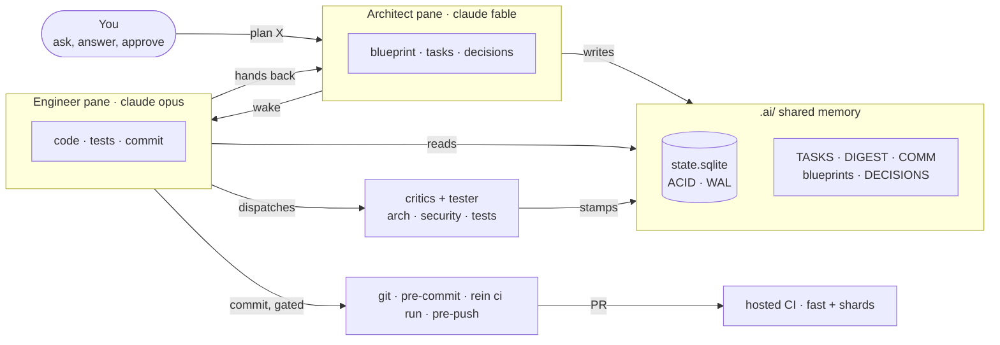

<div align="center">

<picture>
  <source media="(prefers-color-scheme: dark)" srcset="docs/assets/rein-mark-animated-dark.svg">
  
</picture>

# Rein

**Rein in your agents.**

Claude Code as a small engineering team that plans, builds, reviews and remembers.

[![CI][ci-badge]][ci]
[![Privacy][privacy-badge]][privacy]
[![CodeQL][codeql-badge]][codeql]
[![OpenSSF Scorecard][scorecard-badge]][scorecard]
[](LICENSE)
[![Version][version-badge]](CHANGELOG.md)
[![Sponsor][sponsor-badge]][sponsor]

</div>

**One chat forgets. A team remembers.** A single Claude session loses the plan when its context
fills. Rein keeps the plan, the tasks, the decisions and the review stamps in `.ai/`, in a
crash-safe store that every session reads first.

**Plan and build are different jobs.** An Architect pane cannot touch source, and an Engineer
pane cannot rewrite the plan. Each wakes the other when its turn ends; you watch and answer.

**Nothing merges on trust.** Independent critics review the diff, and tests run in a clean
worktree. A commit without a fresh review stamp is refused by a hook, not by a request.

**Local, thin, yours.** No proxy, no cloud service, no account beyond Claude Code. Rein is
open source under the [Apache License 2.0](LICENSE).

**Who it is for:** a solo developer who wants a second opinion that cannot be talked out of the
rules · a small team that wants one memory per repository · an existing codebase that needs to
be understood before it is changed.

---

- [How it works](#how-it-works)
- [Quickstart (60 seconds)](#quickstart-60-seconds)
- [Feature tour](#feature-tour)
- [Command reference](#command-reference)
- [FAQ](#faq)
- [Where this comes from](#where-this-comes-from) · [Contributing](#contributing) · [Security](#security) · [Sponsoring](#sponsoring) · [Licence](#licence)

Step-by-step install for every OS: [docs/install.md](docs/install.md). All guides:
[docs/](docs/README.md).

---

## How it works



**Two roles, one memory.** Each pane is Claude Code bound to a role by `rein pane <role>`. The
Architect (model `fable`) owns the blueprint and the task list; the Engineer (model `opus`) owns
the source and the tests. A headless Tester (`sonnet`) writes tests when the Engineer asks.
→ [The roles](docs/how-it-works.md#the-roles)

**Memory that survives the chat.** Tasks, decisions, review stamps and handoffs live in
`.ai/state.sqlite`, which is WAL-mode, so two sessions never corrupt it, and they are mirrored
to readable Markdown. Each session starts from a 20–60 line snapshot, not from your whole
repository. → [Memory](docs/how-it-works.md#memory-that-survives-the-chat)

**Ping-pong, not copy-paste.** When a role finishes, it writes a short handoff to `.ai/COMM.md`
and wakes the other pane with Claude Code's `SendMessage`. A closed pane gets one
"not reachable" line; nothing is queued behind your back.
→ [The wake](docs/how-it-works.md#the-wake)

**Tested where it counts.** `rein ci run` tests the committed sha in a clean worktree under a
throwaway `HOME`. The pre-push hook requires it, and so does closing a task. Hosted CI repeats it
on Linux and macOS. → [CI](docs/ci.md)

---

## Quickstart (60 seconds)

You need macOS, Linux or Windows through WSL2, with **Node.js 22+**, `git`, `sqlite3`,
`python3` and `tmux`. Starting from an empty machine? Follow [docs/install.md](docs/install.md).

```bash
# 1. Claude Code — skip if `claude --version` already prints a version
curl -fsSL https://claude.ai/install.sh | bash   # official installer: https://code.claude.com/docs/en/setup
claude --version                                 # in a NEW terminal; then run `claude` once to log in

# 2. Rein, once per machine
git clone https://github.com/Vimurai/rein.git && cd rein
bash install-rein.sh                             # copies the framework to ~/.rein, adds it to PATH
exec "$SHELL"                                    # reload the shell so `rein` is found
rein install                                     # Claude Code settings and hooks
rein doctor                                      # each ✗ names its fix

# 3. Your project, new or existing
cd ~/code/my-project
rein init                                        # creates .ai/, .claude/, .mcp.json; never overwrites your files
rein start                                       # tmux: Engineer pane (left) + Architect pane (right)
```

Then type your first request into the **Architect** pane:

> *Plan a `/health` endpoint that reports the app version and database status.*

The Architect writes `.ai/blueprints/health.md`, adds `E-##` tasks to `.ai/TASKS.md`, and
wakes the Engineer. The Engineer implements them, runs the tests and the critics, commits, and
hands back. For an existing codebase, start with *"Reverse-engineer this repository into
`.ai/DIGEST.md`, `.ai/BRIEF.md` and `.ai/architect.md`."*

---

## Feature tour

| Outcome | How | Read more |
| :--- | :--- | :--- |
| **The plan outlives the chat** | `.ai/` holds the blueprint, tasks, decisions, digest, log and review stamps in ACID SQLite, mirrored to Markdown. | [How it works](docs/how-it-works.md#the-ai-directory) |
| **Planning and building stay apart** | Architect and Engineer panes, each with its own model, rulefile and permissions; a headless Tester. | [How it works](docs/how-it-works.md#the-roles) |
| **Rules that hold** | A tool-call gate (role boundaries, destructive commands, secrets), a pre-commit review gate, a pre-push CI gate. | [Gates and review](docs/gates-and-review.md) |
| **A second opinion on every diff** | Critics for architecture, security, tests and clean code, each in its own context, stamping `PASS`/`FAIL`. | [Gates and review](docs/gates-and-review.md#critics) |
| **A green commit means the commit** | `rein ci run` tests a committed sha in a clean worktree; a test budget that only moves down; hosted CI on Linux and macOS. | [CI](docs/ci.md) |
| **Procedures the agents follow** | 40+ skills — preflight, task close-out, handoff, debugging, release, dependency and CI gates. | [Agents and skills](docs/agents-and-skills.md) |
| **Specialists on call** | 21 subagents — critics, Tester, security, database, DevOps, performance, chaos, UX, docs. | [Agents and skills](docs/agents-and-skills.md#subagents) |
| **Tools without a server** | 16 local MCP servers (task store, orchestration, safe exec, patching, risk tiers, blueprint alignment, approval, memory…) wired by `rein sync`. | [MCP servers](docs/mcp-servers.md) |
| **More than one developer** | Task claims on the trunk, per-developer id ranges, shared logs. | [Team mode](docs/team-mode.md) |
| **A project on another subscription** | `rein account add` and `rein start --account`. | [Getting started](docs/getting-started.md#a-second-claude-account) |

---

## Command reference

The `rein` CLI sets things up and keeps them healthy; the day-to-day work happens as prompts and
skills inside the two Claude Code panes.

| Command | What it does |
| :--- | :--- |
| `rein install` | Write Claude Code settings and hooks under `~/.claude`; run once after `install-rein.sh`. |
| `rein init [--check]` | Create `.ai/` in a project, or upgrade an existing one; `--check` is a dry run. |
| `rein sync [--github] [--prune-providers]` | Refresh rulefiles, agents, skills, `.mcp.json` and hooks in the project. |
| `rein start [--status\|--kill\|--detach\|--dry-run\|--account <name>]` | Build or reattach the project's two-pane tmux layout. |
| `rein pane <architect\|engineer>` | Launch Claude Code in this pane, bound to a role. |
| `rein doctor [--repair] [--compliance] [--env]` | Diagnose PATH, hooks, MCP servers, roles, state, CI; `--repair` fixes what it can. |
| `rein add-task <description>` | Add a task from the shell. |
| `rein task done <id>` | Close a task through the same gates the agents use. |
| `rein task claim\|release\|claims` | Team mode: claim a task on the trunk before working on it. |
| `rein team add\|show`, `rein trunk` | Team mode: per-developer id ranges; which branch is the trunk. |
| `rein state import\|migrate` | Bring this machine's task index up to what git tracks. |
| `rein ci run\|status\|list\|log\|budget\|hosted` | Local CI and the hosted check — see [CI](docs/ci.md). |
| `rein account list\|add\|remove\|sync` | Extra Claude Code accounts (one config directory per login). |
| `rein clean [--apply] [--restore <date>]` | List, then move to a dated trash, what older versions left behind. |
| `rein gate off [--minutes N]\|on\|status` | Operator-only, time-boxed escape from the tool-call gate (run it in your own terminal). |
| `rein uninstall` | Remove `~/.rein`. |
| `rein version`, `rein --help` | Version; full help. |

Inside Claude Code, the commonly used skills are:

| Skill | When |
| :--- | :--- |
| `rein-preflight` | Runs at every session start: snapshot, open tasks, state checks. |
| `rein-task` | After a task: mark it done (CI must be green), hand over, show the next one. |
| `rein-handoff` | Write the COMM.md note and wake the other pane. |
| `rein-test` | Run your tests; `--generate` dispatches the Tester to write new ones. |
| `rein-review` | Tier-aware review: critics in parallel for risky changes. |
| `rein-debug` | Hypothesis → test → observe loop; commits stay locked until green. |
| `rein-digest`, `rein-archive` | Refresh the project snapshot; rotate long logs. |

The full list is in [docs/agents-and-skills.md](docs/agents-and-skills.md); every config file
and environment variable is in [docs/configuration.md](docs/configuration.md).

---

## FAQ

**Does my code leave my machine?** Only through Claude Code itself, exactly as when you use it
alone. Rein has no server and sends nothing anywhere; telemetry is a local SQLite file you can
disable.

**Do I need two Claude subscriptions?** No. Both panes run on your one Claude Code login. A second
account is optional, for keeping one project on another subscription.

**Can I use it on an existing project?** Yes. `rein init` adds `.ai/` and `.claude/` and never
overwrites your files; ask the Architect to reverse-engineer the codebase first.

**Can I use only one pane?** Yes. The Engineer alone is a disciplined single agent with memory,
gates and critics. You lose the planning half and the automatic handoff.

**How do I turn a gate off?** In your own terminal, `rein gate off --minutes 15 --reason "…"`.
Catastrophic commands still block, and every bypassed call is announced. An agent cannot do this
for you.

**Something is off.** Run `rein doctor`; every ✗ names its fix. The common cases are in
[docs/troubleshooting.md](docs/troubleshooting.md).

---

## Where this comes from

Rein is the successor of a private repository, AI-OS, developed over 678 commits in 2025–2026.
That history stays private because it carries the author's personal data; this repository
starts from a scrubbed snapshot of it and is developed in public from its first commit. Review
stamps carry the project's noreply identity, and personal names, addresses and paths in the
records were replaced with placeholders; nothing else in `.ai/` was changed. Nothing
of substance was lost: every design decision and blueprint is in [`.ai/`](.ai/) — the same
memory the agents read, and the best place to see how Rein builds itself.

---

## Contributing

Contributions are welcome under the Apache License 2.0; sign off each commit (`git commit -s`, the
[Developer Certificate of Origin](CONTRIBUTING.md#sign-your-commits-developer-certificate-of-origin)).
[CONTRIBUTING.md](CONTRIBUTING.md) covers the development setup, writing skills and MCP servers,
the test layers and the commit conventions. Please follow the [Code of Conduct](CODE_OF_CONDUCT.md).

## Security

Please report vulnerabilities privately — see [SECURITY.md](SECURITY.md). Do not open a public
issue for them.

## Sponsoring

Rein is free and funded by its users. If it saves you time, please consider
[sponsoring the work][sponsor]; sponsor tiers and what they include are on the sponsor page.

## Licence

Apache License 2.0 — see [LICENSE](LICENSE) and [NOTICE](NOTICE). The bundled tree-sitter
grammars are MIT-licensed; their notices are in `NOTICE`.

[ci]: https://github.com/Vimurai/rein/actions/workflows/ci.yml
[ci-badge]: https://github.com/Vimurai/rein/actions/workflows/ci.yml/badge.svg
[privacy]: https://github.com/Vimurai/rein/actions/workflows/privacy.yml
[privacy-badge]: https://github.com/Vimurai/rein/actions/workflows/privacy.yml/badge.svg
[codeql]: https://github.com/Vimurai/rein/actions/workflows/codeql.yml
[codeql-badge]: https://github.com/Vimurai/rein/actions/workflows/codeql.yml/badge.svg
[scorecard]: https://securityscorecards.dev/viewer/?uri=github.com/Vimurai/rein
[scorecard-badge]: https://api.securityscorecards.dev/projects/github.com/Vimurai/rein/badge
[version-badge]: https://img.shields.io/github/v/tag/Vimurai/rein?label=version&sort=semver
[sponsor]: https://github.com/sponsors/Vimurai
[sponsor-badge]: https://img.shields.io/badge/sponsor-%E2%9D%A4-ea4aaa.svg
