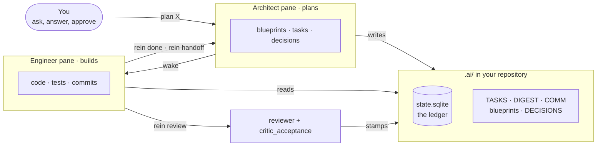
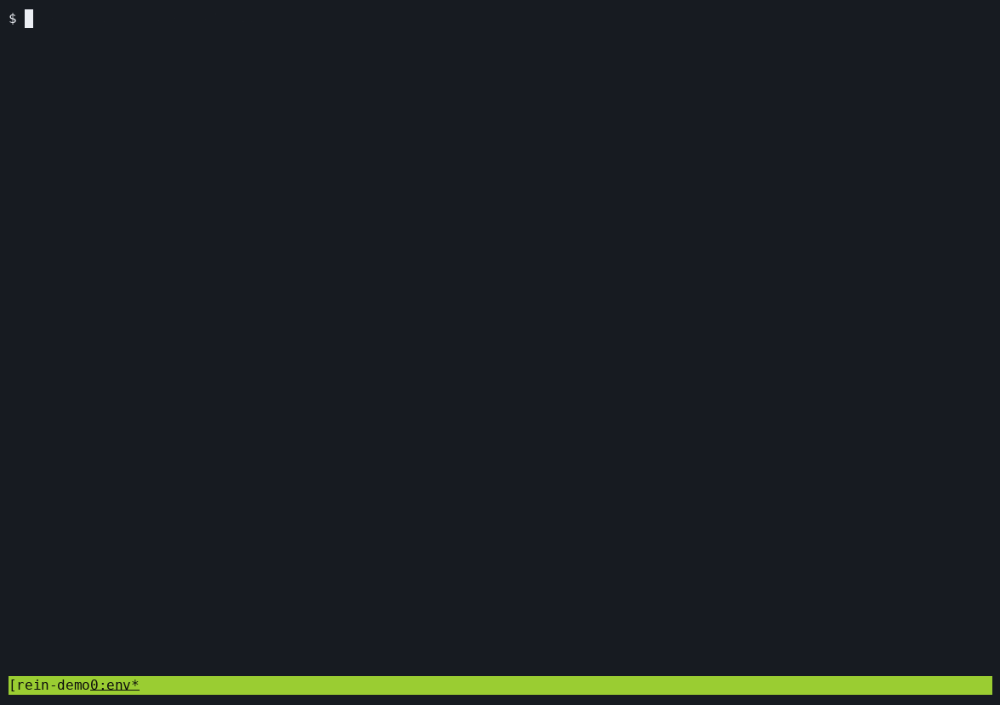

<div align="center">

<picture>
  <source media="(prefers-color-scheme: dark)" srcset="docs/assets/rein-mark-animated-dark.svg">
  
</picture>

# Rein

**Rein in your agents.**

The four things Claude Code does not have: a task ledger, DONE by observed acceptance, a
decision record, and two roles held to their lanes.

[![CI][ci-badge]][ci]
[![Privacy][privacy-badge]][privacy]
[![CodeQL][codeql-badge]][codeql]
[![OpenSSF Scorecard][scorecard-badge]][scorecard]
[](LICENSE)
[![Version][version-badge]](CHANGELOG.md)
[![Sponsor][sponsor-badge]][sponsor]

</div>

Claude Code plans, edits, tests, dispatches subagents and sandboxes commands. Rein adds only
what it lacks:

- **A ledger that outlives the chat.** Tasks, tiers, acceptance text and review stamps live in
  `.ai/state.sqlite` in your repository. Every session starts from a 2 KB brief, not from a
  re-read of the code.
- **DONE means observed.** `rein done` refuses a Tier 2 or 3 task until an independent agent has
  run each acceptance clause against the commit that is checked out, and a reviewer has passed
  the diff.
- **A decision record.** Blueprints, numbered decisions and handoffs, written by commands and
  kept in git.
- **Two roles, enforced.** An Architect pane that can write only `.ai/` and `plans/`, and an
  Engineer pane that builds. Claude Code's own sandbox holds each to its lane; each wakes the
  other when its turn ends.

**Local, thin, yours.** No proxy, no cloud service, no account beyond Claude Code. Rein is
open source under the [Apache License 2.0](LICENSE).





A real run on a throwaway project, recorded with v0.5.0, before the lean-core strip. The
terminal recording is [docs/assets/demo.cast](docs/assets/demo.cast).

---

## Quickstart

You need Linux, WSL2 or macOS with **Node.js 22+**, `git`, `sqlite3`, `python3`, `tmux` and, on
Linux or WSL2, `bubblewrap` and `socat`, plus [Claude Code](https://code.claude.com/docs/en/setup)
installed and logged in. The role sandbox is measured on Linux and WSL2; macOS is not measured
([The role sandbox](docs/role-sandbox.md)). From an empty machine: [docs/install.md](docs/install.md).

```bash
# 1. Rein, once per machine: copies it to ~/.rein, builds the plugin, puts ~/.rein/bin on PATH
git clone https://github.com/Vimurai/rein.git && cd rein
bash install-rein.sh && exec "$SHELL"
rein doctor                                      # each ✗ names its fix

# 2. Your project, new or existing
cd ~/code/my-project
rein init                                        # creates .ai/; never overwrites your files

# 3. The two panes
rein start                                       # tmux: Engineer (left) + Architect (right)
```

**4.** In the **Architect** pane, ask for an outcome: *Plan a `/health` endpoint that reports
the app version and database status.* The Architect writes a blueprint and tasks and wakes the
Engineer, which builds, reviews by tier, and closes each task with `rein done`. Step by step:
[docs/getting-started.md](docs/getting-started.md).

---

## Commands

| Command | What it does |
| :--- | :--- |
| `rein install` | Build the `rein` plugin and add its marketplace to Claude Code (`install-rein.sh` runs it). |
| `rein init [--check]` | Create or upgrade `.ai/`; enable the plugin; write the role settings files. |
| `rein sync` | Refresh the rulefiles, `.mcp.json`, settings and git hooks. |
| `rein doctor [--fitness]` | Diagnose the install and the project; `--fitness` prints the lean-core scorecard. |
| `rein start`, `rein pane <role>` | Open the two panes; launch one pane bound to its role and sandbox. |
| `rein add-task --tier N <text>` | Add a task; its text ends with `Acceptance:` and something observable. |
| `rein done <id> --summary <text>` | Close a task through the completion gates; exit 1 names a missing stamp. |
| `rein handoff --to <role> --file <entry>` | Commit a COMM.md entry and print the wake line for the other pane. |
| `rein decide --file <entry>` | Record a numbered `D-###` decision. |
| `rein review <tier>` | The deterministic checks and the agents to dispatch for the tier. |
| `rein task show <id>` | Print one task, open or closed. |
| `rein archive`, `rein digest build` | Keep the record short; rebuild the digest. |
| `rein state import` | Bring this machine's index up to what git tracks. |
| `rein ci run` | Test a committed sha in a clean worktree; the pre-push hook requires it. |

Every command, including team mode, accounts and releases: [docs/commands.md](docs/commands.md).

## Review by tier

| Tier | Change | Needed before DONE |
| :--- | :--- | :--- |
| 1 | No behaviour change | Nothing |
| 2 | Everything else | `rein:reviewer`, then `rein:critic_acceptance` |
| 3 | The role boundary, the install, hooks, secrets, release signing | Tier 2 plus one `rein:security_engineer` round |

A commit never waits on a review; closing the task does. → [Review by tier](docs/gates-and-review.md)

## What ships

- **One plugin**, `rein`: 4 agents (`reviewer`, `critic_acceptance`, `security_engineer`,
  `test_engineer`) and 5 skills (`blueprint-writer`, `rein-review`, `rein-test`, `rein-debug`,
  `release-manager`), plus the session-start and waiting-signal hooks.
- **One MCP server**, `task-synchronizer-mcp`, the ledger.
- **Git hooks**: pre-commit, pre-push, post-commit, state import.
- **Role settings files** with the sandbox, under `~/.rein/roles/`.

A small seatbelt (a PreToolUse hook) asks before a recursive `rm` of home, root or the project,
a download piped into a shell, or a secret in a command. It is advice; the sandbox is the boundary.
The command gate (E-463) and the rest of v0.5.0 (D-170) are gone; tag `v0.5.0` holds them.

All guides: [docs/](docs/README.md) · what Rein adds: [docs/how-it-works.md](docs/how-it-works.md)
· the sandbox: [docs/role-sandbox.md](docs/role-sandbox.md).

---

## FAQ

**Does my code leave my machine?** Only through Claude Code itself, exactly as when you use it
alone. Rein has no server and sends nothing anywhere.

**Do I need two Claude subscriptions?** No. Both panes run on your one Claude Code login.

**Can I use it on an existing project?** Yes. `rein init` never overwrites your files; ask the
Architect to reverse-engineer the codebase first.

**Something is off.** Run `rein doctor`; every ✗ names its fix. The common cases are in
[docs/troubleshooting.md](docs/troubleshooting.md).

## Where this comes from

Rein is the successor of a private repository, AI-OS, developed over 678 commits in 2025–2026.
That history stays private because it carries the author's personal data; this repository
starts from a scrubbed snapshot and is developed in public. Every design decision and blueprint
is in [`.ai/`](.ai/), the same memory the agents read.

## Contributing

Contributions are welcome under the Apache License 2.0; sign off each commit (`git commit -s`, the
[Developer Certificate of Origin](CONTRIBUTING.md#sign-your-commits-developer-certificate-of-origin)).
See [CONTRIBUTING.md](CONTRIBUTING.md) and the [Code of Conduct](CODE_OF_CONDUCT.md).

## Security

Please report vulnerabilities privately — see [SECURITY.md](SECURITY.md). Do not open a public
issue for them.

## Sponsoring

Rein is free and funded by its users. If it saves you time, please consider
[sponsoring the work][sponsor].

## Licence

Apache License 2.0 — see [LICENSE](LICENSE) and [NOTICE](NOTICE).

[ci]: https://github.com/Vimurai/rein/actions/workflows/ci.yml
[ci-badge]: https://github.com/Vimurai/rein/actions/workflows/ci.yml/badge.svg
[privacy]: https://github.com/Vimurai/rein/actions/workflows/privacy.yml
[privacy-badge]: https://github.com/Vimurai/rein/actions/workflows/privacy.yml/badge.svg
[codeql]: https://github.com/Vimurai/rein/actions/workflows/codeql.yml
[codeql-badge]: https://github.com/Vimurai/rein/actions/workflows/codeql.yml/badge.svg
[scorecard]: https://securityscorecards.dev/viewer/?uri=github.com/Vimurai/rein
[scorecard-badge]: https://api.securityscorecards.dev/projects/github.com/Vimurai/rein/badge
[version-badge]: https://img.shields.io/github/v/tag/Vimurai/rein?label=version&sort=semver
[sponsor]: https://github.com/sponsors/Vimurai
[sponsor-badge]: https://img.shields.io/badge/sponsor-%E2%9D%A4-ea4aaa.svg
