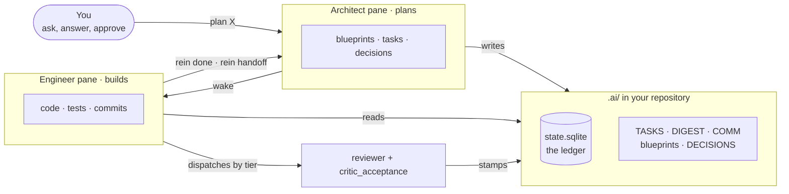
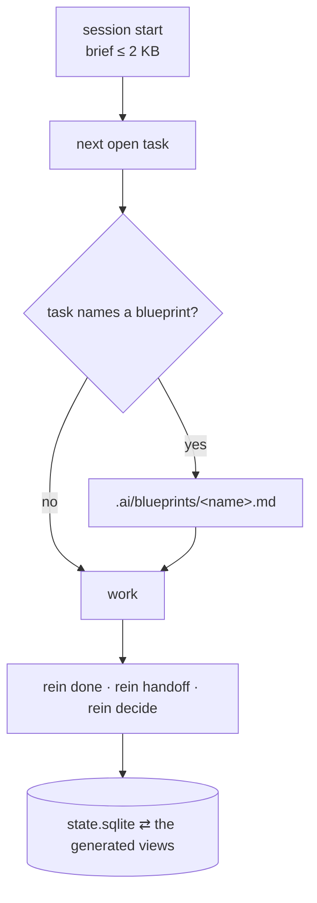

# What Rein adds to Claude Code

Claude Code already plans, edits, runs tests, dispatches subagents and sandboxes commands. Rein
keeps only what it does not have, and nothing else:

1. **A durable task ledger.** Tasks, tiers, acceptance text and review stamps live in
   `.ai/state.sqlite`, in your repository, and outlive every session.
2. **DONE by observed acceptance.** A task closes only when an independent agent has run its
   acceptance clauses and recorded a pass for the commit that is checked out.
3. **A decision record.** Blueprints, numbered decisions and handoff notes, written by commands
   and kept in git.
4. **Two roles with enforced lanes.** An Architect pane that plans and an Engineer pane that
   builds, each held to its lane by Claude Code's own sandbox, and a wake from one to the other.

## The ledger

`.ai/state.sqlite` is the store (SQLite in WAL mode, so two panes never corrupt it).
`task-synchronizer-mcp`, the one Rein MCP server, is how a session reads and writes it; the shell
commands write through the same library. `state.json` is its readable mirror, tracked in git, and
`rein state import` rebuilds a machine's index from what git tracks.

Three views are generated from it and never hand-edited:

| View | Holds |
| :--- | :--- |
| `.ai/TASKS.md` | The open tasks only. `rein task show <id>` prints any task, open or closed. |
| `.ai/REVIEWS.md` | The review stamps (`[REVIEW_PASS]`, `[ACCEPT_FAIL]`, …). |
| `.ai/DIGEST.md` | The project snapshot. `rein digest build` rebuilds it; `rein digest check` says whether it is current. |

Each task has a **tier** and an **acceptance** line. `add_task` refuses a task with no tier, no
imperative verb, or no `Acceptance:` clause that names a command, a file or a count.

## Observed acceptance

`rein done <id> --summary <text>` closes a task through the completion gates:

- **Tier 2 and 3** need `[REVIEW_PASS]` from the `reviewer` agent and `[ACCEPT_PASS]` from
  `critic_acceptance`, each for HEAD (or an ancestor that differs only under `.ai/`). Tier 3 also
  needs `[SEC_CLEARED]` from one `security_engineer` round.
- `critic_acceptance` does not read the diff and agree. It splits the acceptance line into
  clauses and observes each one: it runs the command, opens the file, counts the rows.
- Once a project has run `rein ci run`, the task also needs a green run for HEAD.

A refusal names the missing stamp (`[REVIEW_GATE]`, `[ACCEPT_GATE]`, `[SEC_GATE]`, `[CI_GATE]`)
and exits 1. See [Review by tier](gates-and-review.md).

## The decision record

| File | Written by | Holds |
| :--- | :--- | :--- |
| `.ai/blueprints/<name>.md` | the Architect (skill `blueprint-writer` checks the sections) | One design per feature or domain. |
| `.ai/DECISIONS.md` | `rein decide --file <entry>` | Numbered `D-###` decisions; each needs a decision, a reason and a rollback. |
| `.ai/COMM.md` | `rein handoff --to <role> --file <entry>` | The handoff notes between the roles. |
| `.ai/LOG.md` | `rein done` | One line per closed task. |

`rein archive [--logs]` moves old handoffs and dated sections to `.ai/archive/<FILE>-<year>.md`,
so the files a session reads stay short. `rein handoff` runs it for you.

## Two roles

| Role | Rulefile | Model (default) | Writes | Cannot |
| :--- | :--- | :--- | :--- | :--- |
| **Architect** | `ARCHITECT.md` | `fable`, right pane | `.ai/`, `plans/` | write source, switch the branch, reach the network |
| **Engineer** | `ENGINEER.md` | `opus`, left pane | the source and tests | write `~/.rein` (but its CI logs) or the project's `.claude/` |
| **Tester** | `test_engineer` agent | `sonnet`, headless | tests under `tests/` | — |

`rein pane <role>` starts Claude Code with that role's settings file, which holds the sandbox,
and stamps the session with its role. The lanes are enforced by Claude Code's sandbox, not by
asking the model: see [The role sandbox](role-sandbox.md). Role bindings are data in
`.ai/roles.json`; change a model there and relaunch the pane.

Each session starts with a brief of at most 2 KB that the session-start hook prints: the role,
the branch, the next open tasks, the last handoff and any anomaly. A session reads a blueprint
only when its task names one.

## The wake

`rein handoff --to <role> --file <entry>` appends the entry to `.ai/COMM.md`, commits it with the
other changed `.ai/` files and prints the `SendMessage` line that wakes the other pane. The
session sends it as the last action of its turn, to the pane named `<project> · <Role>`.

- A busy pane receives the message when its current tool call ends.
- A closed pane gets "not reachable". Nothing is queued or retried: relaunch the pane, and the
  note is waiting in `.ai/COMM.md`.

While a pane waits on a permission prompt or a question, the waiting-signal hook sets tmux pane
options that an app can read ([App contract](app-contract.md#6-pane-options)).

## What ships where

| Part | How it is installed |
| :--- | :--- |
| 4 agents, 5 skills, the session-start and waiting-signal hooks | The `rein` Claude Code plugin, built by `rein install` and enabled per project by `rein init` / `rein sync`. |
| Role settings files | Written by `rein init`, `rein pane` and `rein start` under `~/.rein/roles/<project>/` (a plugin cannot carry settings). |
| Git hooks: pre-commit, pre-push, post-commit, state import | Installed into `.git/hooks/` by `rein init` / `rein sync`. |
| The seatbelt (PreToolUse hook on Bash) | The project's `.claude/settings.json`, and the Architect's role file. Advice only (E-463 removed the command gate it replaced). |
| `task-synchronizer-mcp` | The project's `.mcp.json`. |
