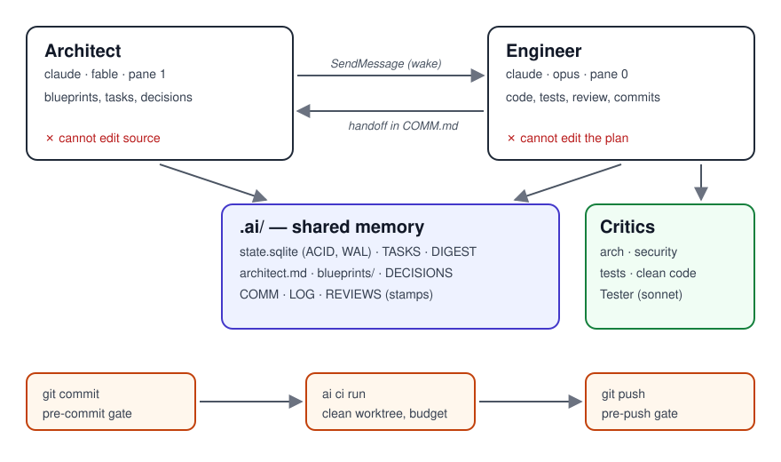

# How it works



## The roles

| Role | Rulefile | Model (default) | Owns | Cannot |
| :--- | :--- | :--- | :--- | :--- |
| **Architect** | `ARCHITECT.md` | `fable`, pane 1 | `.ai/architect.md`, `.ai/blueprints/`, decisions, planning tasks | write source code |
| **Engineer** | `ENGINEER.md` | `opus`, pane 0 | `src/`, `tests/`, implementation tasks, commits | rewrite the blueprint |
| **Tester** | `test_engineer` agent | `sonnet`, headless | tests under `tests/`, test stamps | write outside `tests/` |

`rein pane <role>` launches Claude Code with the role's model and permission overlay
(`.claude/settings.<role>.json`) and stamps the session with its role. The SessionStart hook reads
that stamp, so the right rulefile governs even though `CLAUDE.md` statically imports the Engineer
one. The Tester has no pane: the Engineer dispatches it with `skill: rein-test --generate`.

Role bindings are data, in `.ai/roles.json`. To give the Architect a different model, change it
there and relaunch the pane.

## A task's life

```
you ──"plan X"──▶ Architect ── blueprint + E-## tasks ──▶ .ai/  ──wake──▶ Engineer
                                                                        │
            ┌──────────────── rein-preflight: DIGEST, open tasks ─────────┘
            ▼
   implement ─▶ tests ─▶ critics (by risk tier) ─▶ commit (pre-commit gate)
            │                                          │
            │                                    rein ci run (clean worktree)
            ▼                                          │
   rein-task: mark DONE (needs green CI) ─▶ handover ─▶ next task, or wake the Architect
```

1. **Plan.** You describe the intent to the Architect. It reads the snapshot, writes or amends a
   blueprint under `.ai/blueprints/`, records any decision in `.ai/DECISIONS.md`, and adds
   implementation tasks (`E-##`) with acceptance criteria. Its last action is to wake the
   Engineer.
2. **Implement.** The Engineer's session starts with `skill: rein-preflight`: the digest, the open
   tasks, sync and health checks. It implements the next task, under the gates.
3. **Validate.** `skill: rein-test` runs the project's own test command; `--generate` has the Tester
   write missing tests.
4. **Review.** `skill: rein-review` classifies the change's risk tier and runs the matching critics.
5. **Commit.** The pre-commit gate checks for a review stamp; `rein ci run` tests the commit in a
   clean worktree.
6. **Close.** `skill: rein-task` marks the task done — refused until CI is green — records the
   delta for the Architect, and moves on. When the queue is empty, it wakes the Architect.

## The handoff

When a role finishes, its skill appends a structured entry to `.ai/COMM.md` (what was built,
decisions, divergence from the blueprint, next action, open risks), commits it, and — as the last
action of the turn — calls Claude Code's `SendMessage` to the other pane's session, named
`<project directory> · <Role>`.

- A busy pane receives the message when its current tool call ends.
- A closed pane makes the send fail with "not reachable". The skill prints one line naming the
  undelivered handoff and stops: no retry, no queue. Relaunch the pane and carry on.

## The `.ai/` directory

```
.ai/
  state.sqlite       ACID task store (WAL mode). Never hand-edit.
  state.json         Readable mirror of it, tracked in git.
  DIGEST.md          The 20–60 line project snapshot every session reads first.
  TASKS.md           Planning (P-##) and implementation (E-##) tasks — a generated view.
  architect.md       The system blueprint. Architect-owned.
  blueprints/        One blueprint per domain or feature.
  DECISIONS.md       Decisions (D-###): context, rulings, rejected alternatives.
  BRIEF.md           Product goals, non-goals, constraints.
  RULES.md           Token economics and the role contract.
  CAPABILITIES.md    Paths and commands the agents may use (an input to the security gate).
  REVIEWS.md         Review stamps ([ARCH_PASS], [SEC_FAIL], …) — a generated view.
  LOG.md             Append-only action log; rotated past 200 lines.
  COMM.md            Handoff notes between the roles.
  SESSION.md         Per-session preflight stamps.
  REPO_MAP.md        A token-budgeted map of the code (most central files, signatures only).
  roles.json, providers.json, start.json, team.json   Configuration.
  archive/YYYY-MM/   Rotated LOG, COMM and REVIEWS.
```

`TASKS.md` and `REVIEWS.md` are regenerated from the store: change tasks through the agents'
tools or `rein add-task` / `rein task done`, never by hand. `.ai/` is primary memory — when the chat
and the files disagree, the files win.

## Context economy

A session never reads the whole repository. It reads `DIGEST.md` first, `TASKS.md` second, and a
blueprint only when the task names it. Skills load their full text only when invoked; until then
only a one-line description is in context. Subagents (critics, specialists) run in their own
context and return a short report, so their file reads never land in the main session.
`REPO_MAP.md` gives orientation without opening files.
