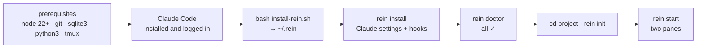

# Install Rein

From an empty machine to an Architect and an Engineer pane, one step at a time. Nothing is
assumed installed. Each step says why, gives the commands, and says what you should see.



1. [Pick your OS](#1-pick-your-os)
2. [Prerequisites](#2-prerequisites)
3. [tmux in five keys](#3-tmux-in-five-keys)
4. [Claude Code](#4-claude-code)
5. [Rein](#5-rein)
6. [Your first project](#6-your-first-project)
7. [Upgrade and uninstall](#7-upgrade-and-uninstall)
8. [If something is off](#8-if-something-is-off)

## 1. Pick your OS

Rein is bash: its installer and its hooks run in a Unix shell. That gives three paths.

- **macOS** — use the Terminal app (or any other); continue with [macOS](#macos).
- **Linux** — continue with your distribution: [Ubuntu/Debian](#ubuntu--debian),
  [Fedora](#fedora) or [Arch](#arch).
- **Windows** — Rein runs inside **WSL2**, the Linux that ships with Windows. In PowerShell as
  administrator:

  ```powershell
  wsl --install -d Ubuntu
  ```

  ([Microsoft's guide](https://learn.microsoft.com/windows/wsl/install); documented, not run for
  this guide.) Restart when asked, then open **Ubuntu** from the Start menu and create your Linux user.
  [Windows Terminal](https://aka.ms/terminal) is recommended. **Everything below runs inside
  that Ubuntu window**, never in PowerShell; follow [Ubuntu/Debian](#ubuntu--debian). Keep your
  projects in the Linux file system (`~/code/…`), not under `/mnt/c`: it is much faster and
  keeps file permissions intact.

## 2. Prerequisites

Rein needs five tools: **Node.js 22 or later** (the MCP servers use the built-in `node:sqlite`),
**git**, **sqlite3** (the hooks read the task store), **python3** (it renders `.mcp.json`) and
**tmux** (the two-pane layout). `curl` is needed once, for Claude Code's installer.

### macOS

With [Homebrew](https://brew.sh) installed:

```bash
brew install node git sqlite python tmux
```

*Documented, not run:* these are Homebrew's own package names; the block was not run on a Mac
for this guide. If you confirm it on macOS, an issue saying so is welcome.

### Ubuntu / Debian

```bash
sudo apt update
sudo apt install -y nodejs npm git sqlite3 python3 tmux curl ca-certificates
```

Ubuntu 26.04 ships Node 22. Older releases ship an older Node: check `node --version` after the
block, and if it prints less than `v22`, install Node 22 or later the way
[nodejs.org's download page](https://nodejs.org/en/download) describes (a version manager such
as fnm or nvm, or the NodeSource packages).

### Fedora

```bash
sudo dnf install -y nodejs git sqlite python3 tmux curl
```

*Documented, not run* on Fedora for this guide; Fedora 40 and later ship Node 22. On an
older release, use fnm as above.

### Arch

```bash
sudo pacman -S --needed nodejs npm git sqlite python tmux curl
```

*Documented, not run* on Arch for this guide.

### Check

```bash
node --version
git --version
sqlite3 --version
python3 --version
tmux -V
```

*What you should see* — one line each, with at least these versions (yours may be newer):

```
v22.x.x            ← 22 or later; the Rein installer refuses anything older
git version 2.x
3.x.x …            ← sqlite3
Python 3.10 or later
tmux 3.x
```

## 3. tmux in five keys

`rein start` lays the two Claude Code panes out side by side in tmux. You need five keys. Each
starts with the **prefix**, `Ctrl-b`: press it, let go, then press the key.

| Keys | Does |
| :--- | :--- |
| `Ctrl-b` `o` | Move to the other pane. |
| `Ctrl-b` `%` | Split the pane left/right (only for the manual layout below). |
| `Ctrl-b` `[` | Scroll: arrow keys or PgUp/PgDn, `q` to leave. |
| `Ctrl-b` `d` | Detach: tmux and both agents keep running in the background. |
| `tmux attach -t <name>` | Come back (in a shell); `rein start` does the same for you. |

Optional, not required — a `~/.tmux.conf` that turns on the mouse (click a pane, scroll with the
wheel) and full colour:

```bash
cat >> ~/.tmux.conf <<'EOF'
set -g mouse on
set -g default-terminal "tmux-256color"
EOF
```

Use **one tmux session per project**, named after it. `rein start` does this for you. A session
has one current window that all attached terminals share, so two projects in one session switch
each other's screen.

## 4. Claude Code

Every Rein role is a Claude Code session, so Claude Code must be installed and logged in first.
The commands below are quoted from Anthropic's official setup page,
<https://code.claude.com/docs/en/setup>. If the page differs from this text, the page wins.

**macOS, Linux and WSL2** — the native install, the page's recommended path
([source](https://code.claude.com/docs/en/setup)):

```bash
curl -fsSL https://claude.ai/install.sh | bash
```

Alternatives from the same page, one line each:

- Homebrew: `brew install --cask claude-code` ([source](https://code.claude.com/docs/en/setup))
- WinGet (native Windows): `winget install Anthropic.ClaudeCode` ([source](https://code.claude.com/docs/en/setup))

For completeness, the native Windows installers
([source](https://code.claude.com/docs/en/setup)). Rein itself runs inside the WSL2
distribution, where the macOS/Linux/WSL2 line above applies:

```powershell
# Windows PowerShell
irm https://claude.ai/install.ps1 | iex
```

```bat
:: Windows CMD
curl -fsSL https://claude.ai/install.cmd -o install.cmd && install.cmd && del install.cmd
```

**Verify.** The installer shows no progress while it downloads. When it finishes, open a **new**
terminal and run:

```bash
claude --version
```

*What you should see:* a version number followed by `(Claude Code)`, for example
`2.1.314 (Claude Code)`.

If the shell says `command not found: claude`, the install directory `~/.local/bin` is not on
your `PATH` yet. The installer says so under `Setup notes:`. Add it to your shell's rc file
([Fix your PATH](https://code.claude.com/docs/en/troubleshoot-install#command-not-found-claude-after-installation)):

```bash
# bash on Linux / WSL2
echo 'export PATH="$HOME/.local/bin:$PATH"' >> ~/.bashrc && source ~/.bashrc
# zsh (the macOS default)
echo 'export PATH="$HOME/.local/bin:$PATH"' >> ~/.zshrc && source ~/.zshrc
```

**Log in.** Run `claude` once:

```bash
claude
```

*What you should see:* Claude Code asks you to log in and offers the login methods. Pick your
**Claude subscription** (Pro, Max, Team or Enterprise; the free plan does not include Claude
Code) or the **Anthropic Console** (API access with pre-paid credits). Complete the login in
the browser it opens; back in the terminal, the session starts. Type `/exit` to leave. Later,
`/login` inside a session switches accounts.

## 5. Rein

Clone the repository and run its installer. It copies the framework to `~/.rein`, installs
the MCP servers' dependencies, and adds `~/.rein/bin` to your `PATH`.

```bash
git clone https://github.com/Vimurai/rein.git && cd rein
bash install-rein.sh
exec "$SHELL"            # reload the shell so `rein` is found
rein install             # Claude Code settings and hooks under ~/.claude
rein doctor
```

*What you should see:* the installer ends with a summary and no `[ERROR]` line. `rein install`
lists the settings and hooks it wrote. `rein doctor` prints sections of `✓` lines. A `✗` line
names its own fix:

| `rein doctor` line | Means | Fix |
| :--- | :--- | :--- |
| `✗ NO — add to shell: export PATH="$HOME/.rein/bin:$PATH"` | The installer's PATH line is not loaded. | Open a new terminal, or run the export line it prints. |
| `✗ rein on PATH: … (shadowed by …)` | Another `rein` comes first on `PATH`. | Remove it, or put `~/.rein/bin` first. |
| `✗ ~/.claude missing` | Claude Code has never run. | [Step 4](#4-claude-code): run `claude` once. |
| `✗ node not found — MCP servers need Node.js` | Node is missing. | [Step 2](#2-prerequisites). |
| `✗ <server>: node_modules missing — run: rein mcp-setup` | An MCP server's dependencies are missing. | `rein mcp-setup` |
| `✗ stop-hook.sh missing — run: rein install` | The Claude Code hooks are not installed. | `rein install` |
| `✗ tmux not found — 'rein start' exits 2 …` | tmux is missing. | [Step 2](#2-prerequisites), or use the manual layout below. |
| `✗ hook toolchain: … missing — run: bash install-rein.sh` | The install is incomplete. | Rerun `bash install-rein.sh`. |
| `✗ .claude/settings.json missing … — run: rein sync` | Inside a project: it was set up by an older Rein. | `rein sync` |
| `✗ .git/hooks/pre-commit: Gate 2 NOT installed — run: rein init` | Inside a project: the git hooks are missing. | `rein init` |
| `✗ local CI: no run for HEAD … — run: rein ci run` | Inside a project: the current commit has not been tested. | `rein ci run`; see [CI](ci.md). |
| GitHub CLI, Copilot or Chromium lines | Optional tools. | Only the features they power are off. |

Outside a project, `rein doctor` skips the project sections; run it again after step 6.

## 6. Your first project

`rein init` turns a git repository into a Rein project. It works the same on a new repository
and an existing one.

```bash
mkdir -p ~/code/my-project && cd ~/code/my-project
git init                 # skip in an existing repository
rein init
```

*What you should see:* a list of what was created, then the next steps. In the repository:

- `.ai/` — the project memory: tasks, blueprints, decisions, the digest (see
  [How it works](how-it-works.md#the-ai-directory));
- `.claude/` — the agents, the skills and one settings overlay per role;
- `.mcp.json` — the MCP servers Claude Code starts for this project;
- `ENGINEER.md`, `ARCHITECT.md` and a `CLAUDE.md` that imports the Engineer rulefile;
- `.github/copilot-instructions.md`, the lines it needs in `.gitignore`, and the git hooks
  (`pre-commit`, `pre-push`, `post-commit`).

It never overwrites what you wrote: `BRIEF.md`, `TASKS.md`, `LOG.md`, `DIGEST.md`,
`architect.md` and your blueprints stay yours, so running it again is safe.
`rein init --check` lists what it would change without changing it.

**Start the team:**

```bash
rein start
```

*What you should see:* a tmux session named after the project, with two panes. On the left is
the **Engineer** (`claude`, model `opus`); on the right is the **Architect** (`claude`, model
`fable`). Each pane opens Claude Code bound to its role and runs its preflight.

Move to the Architect pane (`Ctrl-b` `o`) and type your first request:

> *Plan a `/health` endpoint that reports the app version and database status.*

The Architect writes `.ai/blueprints/health.md`, adds `E-##` tasks to `.ai/TASKS.md`, and
wakes the Engineer. The Engineer implements the tasks, runs the tests and the critics, commits,
and wakes the Architect again. You answer questions and approve. For an existing codebase, ask
first: *"Reverse-engineer this repository into `.ai/DIGEST.md`, `.ai/BRIEF.md` and
`.ai/architect.md`."* The first hour is in [Getting started](getting-started.md).

**Stop and come back.** `Ctrl-b` `d` detaches and leaves both agents running. `rein start` in
the project directory reattaches; it is idempotent. To end the session, run
`rein start --kill`, which asks first (`--yes` skips the question). `rein start --status` shows
which panes exist and what each runs. `rein start --dry-run` prints the tmux commands instead of
running them.

<details>
<summary>Manual fallback: the layout without rein start or without tmux</summary>

Two panes and two commands. In tmux, one session per project:

```bash
tmux new-session -s "$(basename "$PWD")"
# split with Ctrl-b %, then one command in each pane:
rein pane engineer       # pane 0 — Claude Code bound to the Engineer (opus)
rein pane architect      # pane 1 — Claude Code bound to the Architect (fable)
```

Without tmux, open two terminals in the project and run one command in each. Each keeps its
shell when Claude Code exits, so you can run it again. Use another terminal for `rein sync`,
`rein doctor` and git.

</details>

## 7. Upgrade and uninstall

**Upgrade** — pull, reinstall, then refresh each project:

```bash
cd rein && git pull && bash install-rein.sh
cd ~/code/my-project && rein init && rein sync && rein doctor
```

`rein sync` refreshes the rulefiles, `.mcp.json`, `.claude/agents/`, `.claude/skills/` and the
git hooks. It never touches what you wrote. Restart both Claude Code panes afterwards so the MCP
servers run the new code. Older versions leave files behind: `rein clean` lists them,
`rein clean --apply` moves them to `~/.rein/trash/<date>/`, and `rein clean --restore <date>`
puts them back.

**Uninstall:**

```bash
rein uninstall           # removes ~/.rein after you type "uninstall"
```

It leaves the rest for you to remove by hand: each project's `.ai/`, `.mcp.json`, `.claude/` and
git hooks; `~/.claude/`, which holds your own Claude Code settings too; and the
`export PATH="$HOME/.rein/bin:$PATH"` line in your shell rc.

## 8. If something is off

Start with `rein doctor`. These are the five most common failures:

| Symptom | `rein doctor` says | Fix |
| :--- | :--- | :--- |
| No tmux | `✗ tmux not found — 'rein start' exits 2 and prints the manual recipe instead` | Install tmux ([step 2](#2-prerequisites)), or use the manual layout. |
| Node too old | The installer stops with `[ERROR] Node.js 22+ required (found v20…)`; doctor's `✓ node v…` line shows the version | Install Node 22 or later ([step 2](#2-prerequisites)), then rerun `bash install-rein.sh`. |
| `rein: command not found` | `✗ NO — add to shell: export PATH="$HOME/.rein/bin:$PATH"` | Open a new terminal, or add that line to your shell rc. |
| Claude not logged in | `✓ account: default (~/.claude, login: logged out)` | Run `claude` and log in ([step 4](#4-claude-code)). |
| Hooks not installed | `✗ stop-hook.sh missing — run: rein install`, or in a project `✗ .git/hooks/pre-commit: Gate 2 NOT installed — run: rein init` | `rein install`, then `rein init` in the project. |

More symptoms and the FAQ: [Troubleshooting](troubleshooting.md).
